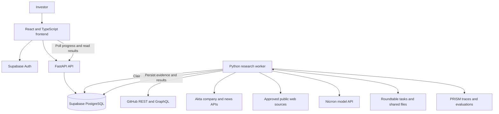

# Gradient architecture

> Implementation update: the research-module contract, run coordinator, opportunity assembler and frontend API flow are now implemented. See [Module integration](MODULE_INTEGRATION.md). Peter owns the research implementations and sponsor workflows; the default registry remains unavailable until those are registered. The broader persistence/authentication design below is still planned.

> **Scope:** This document describes the broader proposed system. The current single-process demo and agent graph are specified in [Backend design](BACKEND_DESIGN.md).

> **Status: frontend demo and backend collection layer implemented.** The frontend still uses synthetic fixtures. `backend/gradient/` now provides source adapters, a bounded async coordinator, evidence grouping, and a FastAPI collection endpoint. The database, research-agent graph, Roundtable/PRISM integrations, and deployments remain proposed. See [backend implementation and limits](../backend/README.md) and [frontend behavior](../frontend/README.md).

Gradient turns an investor's thesis into a shortlist of technical builders with evidence of user demand, commercial context, and questions for a first meeting. See the [product plan](PROJECT_PLAN.md) for positioning and event requirements.

## System overview



The API authenticates users, validates requests, and serves results. A separate worker performs research. PostgreSQL holds application records and job state. Roundtable carries agent handoffs and versioned research artifacts. PRISM observes and evaluates execution.

## Technology choices

### Frontend

| Technology | Responsibility |
| --- | --- |
| React + TypeScript | Typed components and application state. |
| Vite | Local development and production builds. |
| Tailwind CSS | Styling based on the supplied discovery, shortlist, and founder-detail designs. |
| shadcn/ui | Accessible dialogs, tabs, filters, badges, tables, and evidence drawers. |
| React Router | Discovery, run results, saved opportunities, and brief routes. |
| TanStack Query | API requests, caching, mutations, and progress polling. |
| Recharts | Demand timelines and repository activity charts. |
| Lucide React | Consistent interface icons. |

Keep filters and selections in React state or the URL; a separate global state library is unnecessary initially. Use the backend's OpenAPI schema as the shared API contract. The frontend never calls paid sponsor APIs with secret credentials.

### Backend and infrastructure

| Technology | Responsibility |
| --- | --- |
| Python + FastAPI | Application API and generated OpenAPI documentation. |
| Pydantic | Request, response, and model-output validation. |
| HTTPX | External HTTP integrations, including Nicrron's compatible inference endpoint. |
| SQLAlchemy + Alembic | Database access and schema migrations. |
| Supabase PostgreSQL | Structured entities, evidence, jobs, saved opportunities, and brief versions. |
| Supabase Auth | Login; FastAPI verifies tokens and workspace membership. |
| Python worker process | Bounded research jobs with persistent progress and retries. |
| pytest | Identity, evidence, job-state, authorization, and API tests. |
| Playwright | Search-to-brief browser workflow and failure-state checks. |

Proposed hosting: Vercel for the static frontend, Railway for the API and worker, and Supabase for PostgreSQL and authentication. Hosting accounts, limits, and deployment configuration must be verified before use.

Use one worker initially, with PostgreSQL as the job queue. Add a dedicated queue only when concurrency or throughput requires it. The demo's LangGraph handles agent control flow; relational links remain sufficient for the evidence map.

## Screen-to-data mapping

| Screen | Backend data and behavior |
| --- | --- |
| Discovery | Thesis input, explicit criteria, source coverage, and creation of a research run. |
| Shortlist | Run-specific candidates, demand summaries, recent triggers, recommendations, and uncertainty. |
| Founder brief | Person/project links, verified claims, market context, sources, timeline, and meeting questions. |
| Saved opportunities | Workspace-scoped saved candidate references. |
| Research run details | Stage status, source failures, agent handoffs, version IDs, and PRISM trace references. |

The supplied designs are layout references. Their fictional names, quotations, revenue, employers, confidence percentages, and performance figures are not source data. Show unknowns explicitly; only render computed metrics when their inputs and methodology exist. Default to observed evidence labels rather than numerical probabilities of founder success.

## Discovery and data sources

### Route A: project to builder

1. Convert the thesis into explicit topics and bounded GitHub searches.
2. Retrieve relevant repositories, descriptions, releases, issues, comments, and discussions.
3. Identify publicly named maintainers and explicitly linked profiles.
4. Follow declared project/company links to establish possible commercial entities.
5. Research identified companies and competing products through Akta.

### Route B: company to project

1. Use Akta list generation for a company cohort matching the thesis.
2. Retrieve available company details and relevant news.
3. Locate public projects and team information through explicit links.
4. Run the same evidence collection and verification process.

Route A is the first implementation priority; Route B broadens coverage after the core workflow works. Do not require every project to have an Akta company record. Akta can still provide competitor context.

| Source | What it contributes | Access and limitations |
| --- | --- | --- |
| GitHub REST | Repository search, metadata, releases, public profiles, issues, comments, and contribution history. | Use a server-side token. Respect pagination, search limits, rate-limit headers, and incomplete results. |
| GitHub GraphQL | Public repository discussions and their replies. | Verify token permissions and paginate results. |
| Akta | Company search/list generation, company information, and news. | Confirm endpoints and fields available on the event account; obey data display and retention permissions. |
| Official project and company websites | Team, product, pricing, and published adoption claims. | Preserve attribution and distinguish company claims from independently checked facts. |
| Hacker News | Public launches, discussions, and feedback. | Optional extension. The official item API supplies content; keyword search needs a separate permitted search service or a bounded local index. |
| Research papers and author pages | Research-led builders and linked projects. | Later extension; an author is not automatically a company founder. |

Never merge people based on name similarity alone. Repository ownership establishes a project relationship, not necessarily company ownership. Preserve uncertain identity links for review. LinkedIn scraping is excluded by the track brief.

## Sponsor integration boundaries

| Sponsor | Planned adapter | Successful integration evidence |
| --- | --- | --- |
| NicrronNinoo | Model inference for thesis parsing, evidence classification, market synthesis, and verification. | Real model calls and validated structured responses used in a brief. |
| Akta | Company lists, enrichment, competitor context, and news. | A real response contributes attributable information to the assessment. |
| Roundtable | Shared workspace files, agent messages, task handoffs, and version references. | Scout posts evidence; Market Researcher reads it and adds context; Verifier reads and revises the artifact. |
| PRISM | Workflow traces, evaluations, and failure analysis. | Inspectable traces and a reproducible evaluation of an actual correction. |

Use the sponsor Roundtable linked in the [event resources](https://nyc-vc-hack.devpost.com/resources). Its precise SDK contract and authentication still need verification. If it requires a different runtime, isolate that integration behind an adapter; do not substitute an unrelated product named Roundtable.

Roundtable is used for actual handoffs, not merely a copy of a finished report. PostgreSQL stores normalized application results and external artifact/version references. Persist or share third-party content only to the extent permitted by its source and the event account.

PRISM observes the application and provides evaluations; it is not an independent factual data source. Any rule that suppresses a claim in the user interface must also be enforced by our application.

## Research execution

1. **Create run:** the API checks authentication, workspace access, input limits, and available research budget. Store the run with a client idempotency key and return `202 Accepted` with a `run_id`.
2. **Claim job:** the worker atomically leases a queued run in PostgreSQL. Use a heartbeat and lease expiry so an interrupted worker cannot leave a run permanently stuck.
3. **Interpret thesis:** Nicrron returns validated search criteria and exclusions. Preserve the investor's original input.
4. **Scout:** collect bounded public data, normalize evidence, and post candidate tasks and evidence references through Roundtable.
5. **Research market:** consume those tasks, use Akta, and attach attributed context and unknowns to the shared artifacts.
6. **Verify:** inspect original evidence, identity links, independent participants, dates, and contradictory information. Remove or qualify unsupported claims.
7. **Rank and write:** apply explicit criteria and generate structured briefs. Counts and charts come from code over collected data, not invented model outputs.
8. **Persist:** save brief versions, partial-source status, and Roundtable/PRISM references. Mark the run complete, partially complete, or failed.
9. **Display:** the frontend polls status and fetches available results. It stops polling at a terminal state and shows source gaps explicitly.

Suggested run states: `queued`, `running`, `completed`, `partial`, `failed`, and `cancelled`. Store the current stage separately.

Use checkpointed stages and deduplicated writes so retries do not inflate demand counts. If a provider request may have succeeded before a timeout, reconcile it using its request/artifact identifier where supported before resubmitting. Do not promise exactly-once external execution.

## Proposed application API

These are our planned endpoints, not sponsor API routes. All require authentication and workspace checks.

| Method and route | Purpose |
| --- | --- |
| `POST /api/runs` | Start bounded research from a thesis; return run ID and status. |
| `GET /api/runs/{run_id}` | Status, stage, progress, coverage, and errors. |
| `POST /api/runs/{run_id}/cancel` | Request cancellation; worker checks between stages. |
| `GET /api/runs/{run_id}/opportunities` | Ranked, paginated candidate results and explanations. |
| `GET /api/opportunities/{id}` | Candidate details and latest brief reference. |
| `GET /api/opportunities/{id}/brief` | Structured brief, uncertainties, and claim references. |
| `GET /api/evidence/{id}` | Allowed source excerpt, URL, timestamps, and claim relationships. |
| `GET /api/saved` | Saved opportunities for the current workspace. |
| `PUT /api/saved/{opportunity_id}` | Save an opportunity idempotently. |
| `DELETE /api/saved/{opportunity_id}` | Remove a saved opportunity. |

Render and print briefs from structured data for the first export implementation. A dedicated PDF service can follow later.

## Database model

| Table | Core responsibility |
| --- | --- |
| `workspaces`, `memberships` | Team boundaries and user roles. |
| `research_runs` | Thesis, criteria, state, stage, lease, timestamps, limits, and errors. |
| `people` | Public identity references and sourced person attributes. |
| `companies` | Company names, domains, external IDs, and verified context. |
| `projects` | Repository IDs, URLs, descriptions, release data, and source timestamps. |
| `entity_links` | Person/project/company relationships with evidence and verification status. |
| `opportunities` | Run-specific candidate, rationale, recommendation, and unknowns. |
| `evidence` | Source identifiers, permitted excerpts, dates, provenance, and collection scope. |
| `claims`, `claim_evidence` | Structured claims and their supporting or contradicting evidence. |
| `brief_versions` | Immutable structured brief versions and external artifact references. |
| `saved_opportunities` | Workspace/user save relationships. |
| `integration_events` | Provider request references, handoff IDs, trace IDs, and sanitized errors. |

Keep workspace ownership explicit for run-derived records and enforce it on every query. Start with workspace-scoped data rather than sharing research across customers. Use unique source IDs and canonical URLs for deduplication. Store structured provider payloads in JSONB only where retention is permitted.

## Evidence and ranking rules

Every factual claim needs supporting source references. Evidence records distinguish source publication/event time from collection time and include the window and completeness of collection.

- A profile employer is not a verified customer relationship.
- A maintainer is not automatically a founder.
- A request for paid hosting is not a completed purchase.
- Stars and commits do not establish revenue or willingness to pay.
- Missing funding data means unknown, not unfunded.
- Multiple comments from the same person do not represent multiple independent users.
- Multiple articles repeating one announcement do not represent independent confirmation.
- Model agreement is not additional source evidence.

Use separate evidence type and review status fields. Evidence may be direct observation, self-report, or inference; a claim may be supported, uncertain, contradicted, or rejected. This preserves combinations such as a correctly quoted but unverified self-report.

Prioritize thesis fit, independently expressed demand, recency, builder identity, and commercial alternatives. Show the reasons and gaps instead of an unexplained probability of success. Retain contrary evidence alongside positive findings.

## Reliability, access, and configuration

Set per-run limits for candidates, pages, provider calls, tokens, and elapsed time. Retry transient failures with bounded backoff; respect provider rate limits. Stop or mark a stage partial when its budget is exhausted. Show available results without implying all sources succeeded.

Keep sponsor keys, GitHub tokens, database credentials, and privileged Supabase credentials on the backend/worker. The frontend receives only its API base URL and public authentication configuration. Use an explicit frontend-origin allowlist for API CORS and validate authorization independently of CORS.

Fetched pages and comments are untrusted data, not instructions to agents. Restrict tools to the intended research operations, validate model outputs, and protect web fetches against private-network URLs and unsafe redirects. Models must not send messages or modify external accounts during research.

Required setup: Nicrron credentials, Akta event access, Roundtable workspace credentials, PRISM credentials, a GitHub API token, and Supabase database/auth configuration. Environment variable names and exact SDK calls will be finalized during integration setup. Never store secret values in documentation, traces, or commits.

## Deployment and repository layout

The intended layout below is a plan. Only the empty `frontend/` folder and documentation currently exist from this architecture; do not assume the other paths are scaffolded.

```text
flow_hackathon/
  frontend/
    src/
      components/       # Shared UI, evidence cards, and drawers
      pages/            # Discover, shortlist, brief, and run detail
      api/              # Typed backend client and query hooks
      types/            # API response types
  backend/
    app/
      api/              # Routes, authentication, and authorization
      models/           # SQLAlchemy tables
      schemas/          # Pydantic contracts
      integrations/     # GitHub and the four sponsor adapters
      services/         # Discovery, identity, evidence, and ranking
      workers/          # Job leasing and research orchestration
    migrations/
    tests/
  docs/
    ARCHITECTURE.md
    PROJECT_PLAN.md
```

Run the API and worker as separate processes against the same PostgreSQL database. Deploy schema migrations before code that depends on them. Pin dependency versions when scaffolding and commit lockfiles. No installation commands are provided yet because the manifests have not been created.

## Implementation and verification milestones

1. Verify one real interaction with each required sponsor and GitHub.
2. Establish one sourced candidate brief and agree on the response schema.
3. Scaffold the frontend and backend, authentication, and database migrations.
4. Implement GitHub discovery, source collection, and identity/evidence normalization.
5. Connect Roundtable handoffs, Nicrron inference, Akta context, and PRISM tracing.
6. Connect the reference screens to the API and support partial results and unknowns.
7. Test identity ambiguity, duplicate demand, unsupported claims, provider failures, cross-workspace access, and job recovery.
8. Demonstrate a complete live research run and a genuine PRISM-detected failure corrected on identical inputs.

The event resources mention 50+ initial runs and 20+ runs on fixed inputs for the PRISM challenge. Preserve dataset and prompt versions plus trace IDs. Real outcomes determine the comparison; do not fabricate scores or intentionally weaken a baseline. Follow the [product plan](PROJECT_PLAN.md#demo-and-submission) for the final submission checklist.

## Technical references

- [Vite](https://vite.dev/guide/) and [shadcn/ui with Vite](https://ui.shadcn.com/docs/installation/vite)
- [FastAPI](https://fastapi.tiangolo.com/) and [Supabase PostgreSQL](https://supabase.com/docs/guides/database/overview)
- [GitHub search API](https://docs.github.com/en/rest/search/search) and [Discussions GraphQL API](https://docs.github.com/en/graphql/guides/using-the-graphql-api-for-discussions)
- [Hacker News API](https://github.com/HackerNews/API)
- [Nicrron](https://nicrron.ai/), [Akta documentation index](https://docs.akta.pro/llms.txt), and [PRISM documentation](https://blockconvey.com/docs)
- [Official event resources, including the sponsor Roundtable quickstart](https://nyc-vc-hack.devpost.com/resources)

Architecture recorded October 24, 2026. Sponsor-specific contracts and deployment settings remain subject to the account and integration checks above.
