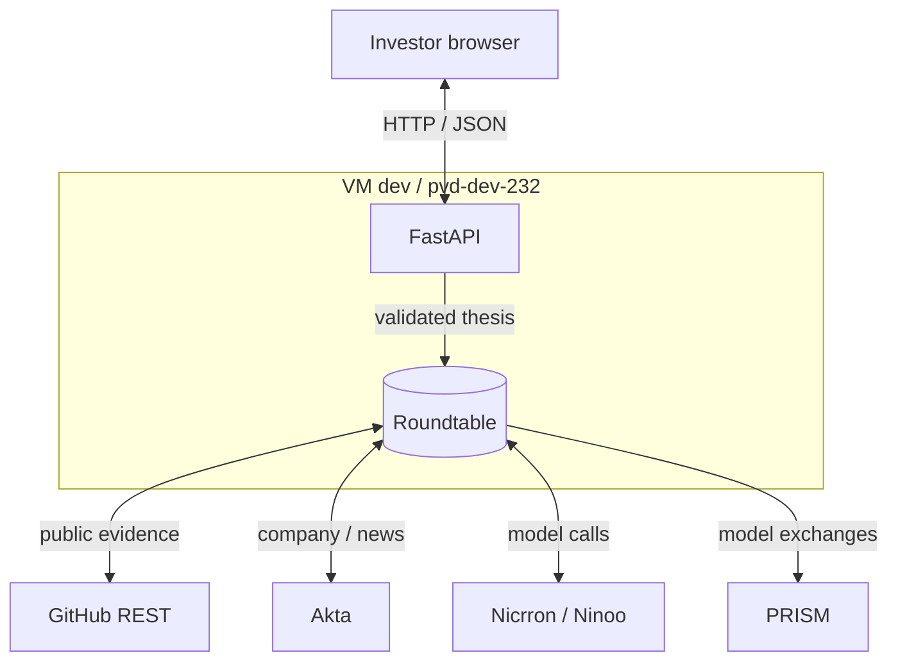

# Gradient: backend design

> **Implementation update:** The modular collection layer now lives in `backend/gradient/`. See [setup and extension contract](../backend/README.md). GitHub and Akta implement a common `DataSource` interface; a coordinator collects concurrent results, groups evidence, and invokes a run-local organizer for bounded follow-ups. The agent graph and remaining sponsor integrations below are still proposed.

**Proposed demo scope.** Turn an investor thesis into three builder briefs backed by public demand evidence and commercial context, using every [required sponsor](../README.md#required-sponsor-integrations).

## 1. Architecture

One Python process runs FastAPI and the research pipeline. The proposed connections below separate public sources, model inference, shared research, and tracing.

FastAPI serves the browser; the pipeline owns external calls. Request memory holds intermediate data. Roundtable is planned to retain shared artifact versions; current collection does not yet persist them.

**Deployment target:** GCP `pvd-dev-232/us-central1-a/dev`, instance `8034442951099769107`; IAP SSH user `pvd2112_columbia_edu`.

## 2. Research mechanism

[Nicrron](https://www.nicrron.ai/docs/api) interprets the thesis. GitHub supplies repositories, README text, issues, comments, and explicitly linked maintainer profiles. Scout extracts demand evidence and writes a Roundtable task/file. Market Researcher reads that artifact, adds [Akta](https://docs.akta.pro/llms.txt) company, competitor, and news context, then hands it to Verifier. Verifier reads the revised artifact, checks claims against excerpts, and writes ranked briefs. These roles are sequential functions.

Each evidence item carries a URL, author ID, excerpt, publication date when available, and collection time. Code rejects unresolved citations and deduplicates source/account IDs. Label self-reports and uncertain founder/customer relationships; preserve counter-evidence. Model verification remains fallible.

Send actual model exchanges to [PRISM](https://blockconvey.com/docs) under `session_id=run_id`; return trace and Roundtable version references.

## 3. API and code

| Endpoint | Contract |
| --- | --- |
| `GET /healthz` | Process health. |
| `GET /api/sources` | Registered sources, operations, and credential availability. |
| `POST /api/research` | Accept `{thesis}`; return `run_id, status, briefs, evidence, integration_refs, warnings`. |

The current endpoint returns `phase: collection`, grouped evidence, source outcomes, and an event history. `briefs` and `integration_refs` remain empty until the research/sponsor stages are connected. `complete` currently means collection completed, not that three briefs exist. A useful partial collection returns HTTP 200 with warnings; 502/504 apply when no source produced a useful outcome. Frontend connection is pending.

Each brief contains builder/project, demand, thesis fit, timing, alternatives, unknowns, and meeting questions. Return fewer than three as `partial`; provider failure returns 502 and deadline expiry 504.

Use [FastAPI](https://fastapi.tiangolo.com/async/), Pydantic, and HTTPX. Implemented files under `backend/gradient/`: `main.py` owns routes, `models.py` defines contracts, `coordinator.py` schedules collection, `evidence.py` normalizes/groups records, `research.py` defines the organizer hook, and `sources/` holds independent adapters. Keep credentials server-side.

## 4. Bounds and verification

Cap each run at six repositories, ten issues/comments per repository, four batched model calls, and 120 seconds. Use 20-second provider timeouts and one active run; reject overlap with 429.

Keep one evidence-rule unit test, one API integration test covering success/provider failure, and one live smoke run proving all sponsors and Roundtable handoffs. Run Ruff, Pyrefly, and pytest.

The 35-minute target assumes working sponsor access. Durable jobs, login, extra sources, and PRISM evaluation batches follow the demo.

## 5. Sources

[Product plan](PROJECT_PLAN.md) and [architecture](ARCHITECTURE.md), inspected at `9fed94c`, October 24, 2026; sponsor and framework references linked above.
