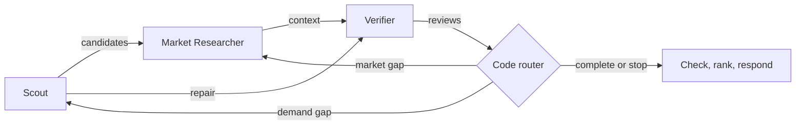

# Pull: backend design

**Proposed agent graph.** Turn an investor thesis into three sourced builder briefs using the [required sponsors](../README.md#required-sponsor-integrations).

## 1. Agent graph

FastAPI invokes one [LangGraph StateGraph](https://docs.langchain.com/oss/python/langgraph/graph-api). Agents have separate instructions, restricted tools, message histories, and validated outputs. A model through [Nicrron](https://www.nicrron.ai/docs/api) chooses queries and permitted tools.

The router reads Verifier's request; repaired Scout results return directly to Verifier. After one repair, unresolved claims become unknown or are omitted.

## 2. Functional ownership

| Agent | Decisions and tools | Output |
| --- | --- | --- |
| Scout | Choose GitHub searches; inspect repositories, issues/comments, and public maintainer links. | Candidates, demand evidence, identity uncertainty. |
| Market Researcher | Choose Akta company, competitor, and news queries; investigate commercial alternatives. | Attributed market context, contrary evidence, unknowns. |
| Verifier | Read evidence by ID; reread allowed GitHub/Akta sources; assess claim support and request targeted research. | Claim reviews and an optional Scout/Market research request. |

Code validates citations, deduplicates evidence/accounts, enforces routing limits, and ranks reviewed candidates by thesis fit, distinct demand accounts, and recency. Verifier's judgments remain fallible.

Shared state carries thesis/criteria, candidates, evidence, reviews, artifact references, and remaining budgets. Evidence retains URL, author, excerpt, event date, and collection time.

Roundtable holds agent output versions and task messages; downstream agents read those versions. Graph state holds references and working copies. PRISM records actual model exchanges under `session_id=run_id`, labeled by agent and graph version.

## 3. API and runtime

`POST /api/research` accepts `{thesis}`; returns `run_id, status, briefs, evidence, integration_refs, warnings`. `GET /healthz` reports process health. Briefs populate Shortlist and Founder Brief.

Apply fixed discovery defaults: AI infrastructure/devtools, open-source projects, demand within 90 days, and publicly verifiable builder links. Return fewer supported opportunities as `partial`; provider failures return 502, deadline expiry 504.

One Python process on `pvd-dev-232/us-central1-a/dev` (instance `8034442951099769107`), IAP user `pvd2112_columbia_edu`. Proposed files: `backend/main.py` for routes/models, `research.py` for graph/agents, `sources.py` for HTTPX tools. Credentials stay server-side.

## 4. Bounds and acceptance

Cap runs at six repositories, ten issues/comments per repository, three model turns per agent invocation, one targeted repair, fifteen model calls total, and 120 seconds. Enforce 20-second provider timeouts and one active run; reject overlap with 429.

Keep one unit test for evidence rules; one parameterized graph/API integration test for success, repair routing/termination, and provider failure; one live smoke run for all sponsors and actual handoffs. Run Ruff, Pyrefly, and pytest.

The 35-minute target assumes working sponsor access. Durable jobs, login, extra sources, and PRISM evaluation batches remain follow-on work.

## 5. Sources

[Product plan](PROJECT_PLAN.md); broader [architecture](ARCHITECTURE.md); official graph/model documentation linked above. Proposed design, October 24, 2026.
