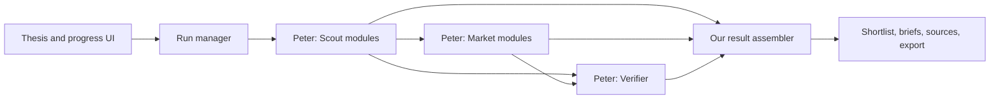

# Research module handoff

**Peter owns research; Arjun owns integration and the UI.** Peter implements each module's source selection, collection, reasoning, sponsor calls, and evidence review. The integration layer schedules these modules, validates their outputs, assembles opportunity views, and delivers them to the frontend. It does not perform model research or pretend the sponsors are connected.

## Working boundary



| Owner | Files / responsibility |
| --- | --- |
| Peter | Research module implementations; LangGraph or other internal research workflow; Nicrron, Akta, Roundtable and PRISM calls; accurate citations and identity links |
| Arjun | `backend/gradient/integration/`: contract, scheduler, aggregation, API; frontend API client, progress, shortlist and briefs |
| Shared contract | `backend/gradient/integration/contracts.py`; serialized schemas in `docs/contracts/` |

The existing `DataSource.collect()` adapters are a lower-level collection utility Peter may reuse. They do **not** satisfy the research-module contract by themselves. `/api/research` still returns collection-only results. The new UI uses `/api/runs`.

## Implement a module

A module exposes a `ModuleSpec` and `async run(context: ModuleContext) -> ModuleOutput`. For example, this is a minimal truthful placeholder, not a research implementation:

```python
from gradient.integration.contracts import ModuleContext, ModuleOutput, ModuleSpec
from gradient.integration.registry import ModuleRegistry

class ScoutModule:
    spec = ModuleSpec(name="scout", label="Builder discovery", role="scout")

    async def run(self, context: ModuleContext) -> ModuleOutput:
        # Replace this partial output with your source/model workflow.
        # Use context.thesis and keep ALL mutable run state inside this call.
        return ModuleOutput(
            run_id=context.run_id,
            module_id=self.spec.name,
            status="partial",
            warnings=("Research implementation pending.",),
        )

def build_modules():
    return ModuleRegistry(ScoutModule())
```

Set `GRADIENT_MODULE_FACTORY=your_package.modules:build_modules` in the backend environment. The factory returns a registry of 1–8 modules. The default server registers unavailable Scout, Market and Verifier placeholders, yielding no fake opportunities. Configure each module's `available` from its required credentials if appropriate.

Use `role="market", depends_on=("scout",)` for market work and `role="verifier", depends_on=("scout", "market")` for review. Multiple independent scouts or market tasks can have distinct names. Unknown dependencies, duplicate names and cycles are rejected on startup. The current runner executes each registered module once; Peter can handle bounded repair loops inside his module, or add explicitly named dependent stages. Runtime task registration and external HTTP worker check-ins are not implemented.

## Output and identity rules

- Copy `context.run_id` and your `spec.name` into the output. One completed output per module per run; identical replay is safe, conflicting replay is rejected.
- Scout establishes `Candidate` records. Use a stable provider/entity ID (such as a GitHub repository node ID), not a display name. Pass that same `candidate_id` downstream. Different IDs are never merged by name similarity.
- Every candidate needs `evidence_ids` supporting the identity/project relationship. Each `Citation` carries the same candidate ID, a public HTTP(S) URL, excerpt, attribution kind, and a limitation. `Provider summary` is distinct from an original observed source.
- Emit `Finding` objects for description, demand, trigger, thesis, market, and uncertainty. All factual fields need citations. Only explicitly labeled uncertainty can be uncited. IDs should be stable and namespaced to avoid accidental collisions.
- `context.outputs` contains completed outputs and `context.module_states` shows failures/timeouts/unavailability. A dependency reaching a terminal state unblocks its dependents, even if it failed. Decide whether to return partial work or stop when evidence is insufficient. Do not assume every dependency produced data.
- Only Verifier-role modules supply `Review`: accepted/rejected finding IDs, recommendation, unknowns and meeting questions. Rejected findings cannot support the brief. A positive recommendation requires an accepted demand finding. The assembler checks references; Peter's verifier must assess whether the cited content actually supports the claim.
- Unresolved or cross-candidate citations are excluded with warnings. Conflicting evidence/finding IDs are excluded; conflicting candidate identities are withheld. Conflicting reviews yield `Needs validation`. Missing values remain unknown; no confidence score, participant count, revenue, activity chart, or company identity is invented.
- `integration_refs` can carry Roundtable/PRISM run IDs or artifact references, but the integration does not treat their presence as proof an integration ran. Do not include credentials or private request headers.
- Models reject extra fields and enforce size limits. Outputs are revalidated before admission. Do not return raw provider error details containing secrets in public warnings.

## Execution and limits

Independent modules run concurrently. Dependency outputs are snapshotted when the module starts, so later results are not injected into an already running call. The assembler recomputes views whenever an output completes, making completion order irrelevant for the same set of outputs.

The single-process runner admits one active module run, allows 120 seconds overall and 60 seconds per module after its dependencies finish, and retains completed outputs if another module fails or times out. Cancellation propagates to child tasks. Modules must use async, cancellation-friendly I/O; they must not block the event loop or suppress cancellation. There are no implicit retries or repeated paid calls.

Run storage is in memory: at most 20 runs, one-hour TTL from creation, lost on restart. Oldest terminal runs may be evicted earlier at capacity. Use one server worker. Saved browser links are not durable copies of server data; export a brief to retain it. The raw-source collection endpoint has its own admission lock. Authentication, shared storage, distributed jobs and persistent sponsor artifacts remain outside this integration slice.

## API consumed by the frontend

| Endpoint | Behavior |
| --- | --- |
| `GET /api/modules` | Specs, dependencies, availability, live/demo mode |
| `POST /api/runs` with `{ "thesis": "..." }` | 202 snapshot immediately; 429 if busy |
| `GET /api/runs/{id}` | Status of every module, warnings, opportunity count |
| `POST /api/runs/{id}/cancel` | Cancel unfinished work; preserve completed outputs |
| `GET /api/runs/{id}/opportunities` | Current assembled results, including provisional ones |
| `GET /api/opportunities/{id}` | Structured brief and citation URLs |

Unknown/expired/withheld resources return 404. Run status can be queued, running, complete, partial, failed, timed_out or cancelled. An empty but successfully researched result can be complete. Completion means execution completed, not that an investment is validated. The UI does not substitute fixtures when API calls fail.

## Basic real-data GitHub Scout

A minimal test implementation is available in `gradient/modules/github_scout.py`. It reuses `GitHubSource` to search up to three public repositories and collect up to three recent issue/comment excerpts per repository. It maps them into the shared module contract, with no model calls or sponsor usage. Repository owner handles are preserved, but founder names, customer demand, thesis fit, company status and investment recommendations remain unverified. Market and Verifier stay unavailable.

From the repository root:

```sh
GRADIENT_MODULE_FACTORY=gradient.modules.github_scout:build_modules \
  backend/.venv/bin/uvicorn gradient.main:app --host 127.0.0.1 --port 8000
```

Select **Research modules** in the UI and try `repo:langfuse/langfuse` or `agent observability`. The input is literal GitHub search syntax (maximum 256 characters), not a natural-language research plan. An optional server-side `GITHUB_TOKEN` helps with public API limits. Empty results and rate limits are reported explicitly; failed issue retrieval retains repository evidence. Outputs remain provisional and the overall run is partial because research/review is incomplete.

With the frontend and this factory running, `npm run test:live-scout` from `frontend/` tests the complete UI flow against public GitHub data. Unlike the fixture test, this opt-in smoke check depends on network access and GitHub availability and does not run in the default unit suite.

## Local integration check

Start the normal API and frontend from the repository root:

```sh
backend/.venv/bin/uvicorn gradient.main:app --host 127.0.0.1 --port 8000
# In a separate terminal:
cd frontend
npm run dev
```

The frontend defaults to `http://127.0.0.1:8000`; set `VITE_API_URL` before starting Vite to change it. Allowed frontend origins are configured with `FRONTEND_ORIGINS` on the backend. Select **Research modules** on the homepage. With the default registry, the run reports unavailable modules; **Demo** still works independently.

For an explicitly synthetic end-to-end test, run this separate fixture server from the repo root:

```sh
GRADIENT_MODULE_FACTORY=gradient.integration.fixtures:build_modules \
  backend/.venv/bin/uvicorn gradient.main:app --host 127.0.0.1 --port 8001
# In another terminal with the frontend dev server running:
cd frontend
npm run test:integration
```

The browser check routes API calls to port 8001 only inside its isolated test context. The normal application remains connected to port 8000. The fixture registry exercises real orchestration and API calls with invented data clearly labeled synthetic. It makes no sponsor or source requests.

Backend checks: `.venv/bin/pytest -q`, `.venv/bin/ruff check gradient tests examples`, and `.venv/bin/pyrefly check --min-severity warn` from `backend/`. Frontend checks: `npm test`, `npm run build`, `npm run test:browser`, and the fixture check above from `frontend/`.
